
 

<picture><source media="(max-width: 700px)" srcset="assets/v3/hero3-en-m.svg"></picture>

<picture><source media="(max-width: 700px)" srcset="assets/v3/intro-en-m.svg">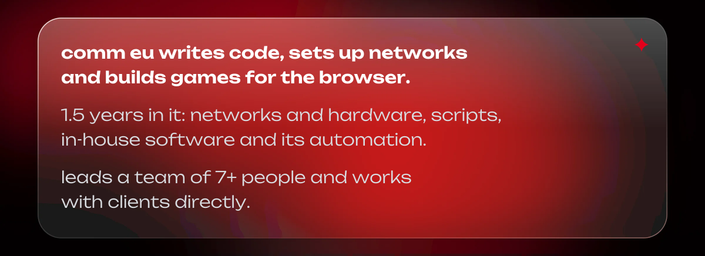</picture>

<picture><source media="(max-width: 700px)" srcset="assets/v3/widgets-en-m.svg"></picture>

<a href="#objects"></a>

<a href="#method"></a>
<a href="#stack"></a>
<a href="#signal"></a>

<picture><source media="(max-width: 700px)" srcset="assets/v3/group-nav-en-m.svg"></picture>

<a href="#release"><picture><source media="(max-width: 700px)" srcset="assets/v3/role-1-en-m.svg">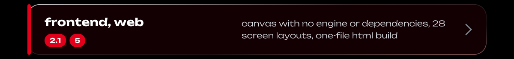</picture></a>
<a href="#release"><picture><source media="(max-width: 700px)" srcset="assets/v3/role-2-en-m.svg">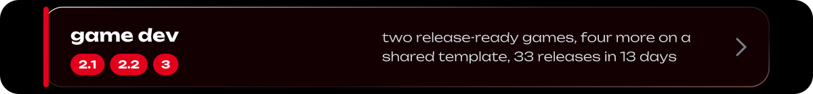</picture></a>
<a href="#release"><picture><source media="(max-width: 700px)" srcset="assets/v3/role-3-en-m.svg">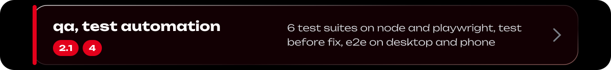</picture></a>
<a href="#infra"><picture><source media="(max-width: 700px)" srcset="assets/v3/role-4-en-m.svg">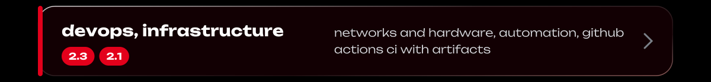</picture></a>
<a href="#infra"><picture><source media="(max-width: 700px)" srcset="assets/v3/role-5-en-m.svg">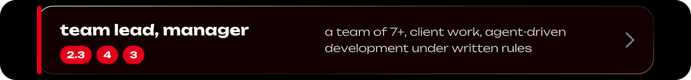</picture></a>

<picture><source media="(max-width: 700px)" srcset="assets/v3/band-objects-en-m.svg"></picture>

<picture><source media="(max-width: 700px)" srcset="assets/v3/group-release-en-m.svg"></picture>

<picture><source media="(max-width: 700px)" srcset="assets/v3/fox-raid-en-m.svg"></picture>

<picture><source media="(max-width: 700px)" srcset="assets/v3/group-spec-en-m.svg"></picture>

<picture><source media="(max-width: 700px)" srcset="assets/v3/fox-spec-en-m.svg">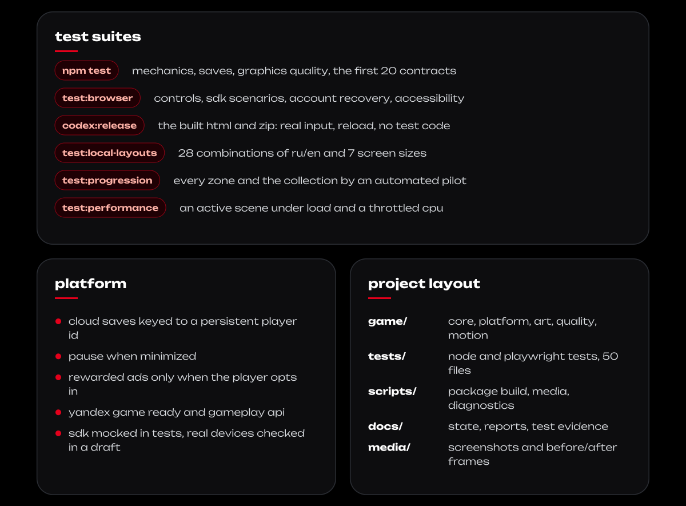</picture>

<picture><source media="(max-width: 700px)" srcset="assets/v3/arena-en-m.svg"></picture>

<picture><source media="(max-width: 700px)" srcset="assets/v3/group-pipe-en-m.svg"></picture>

<picture><source media="(max-width: 700px)" srcset="assets/v3/arena-spec-en-m.svg"></picture>

<picture><source media="(max-width: 700px)" srcset="assets/v3/group-wip-en-m.svg"></picture>

<picture><source media="(max-width: 700px)" srcset="assets/v3/wip-en-m.svg">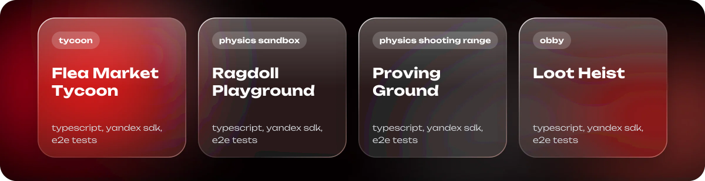</picture>

<picture><source media="(max-width: 700px)" srcset="assets/v3/group-infra-en-m.svg"></picture>

<picture><source media="(max-width: 700px)" srcset="assets/v3/infra-en-m.svg">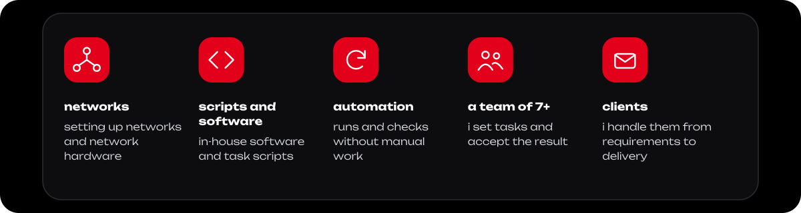</picture>

<picture><source media="(max-width: 700px)" srcset="assets/v3/band-chronicle-en-m.svg"></picture>

<picture><source media="(max-width: 700px)" srcset="assets/v3/chronicle-en-m.svg"></picture>

<picture><source media="(max-width: 700px)" srcset="assets/v3/band-method-en-m.svg"></picture>

<picture><source media="(max-width: 700px)" srcset="assets/v3/method-en-m.svg"></picture>

<picture><source media="(max-width: 700px)" srcset="assets/v3/band-stack-en-m.svg"></picture>

<picture><source media="(max-width: 700px)" srcset="assets/v3/tag-en-m.svg"></picture>

<picture><source media="(max-width: 700px)" srcset="assets/v3/index-en-m.svg">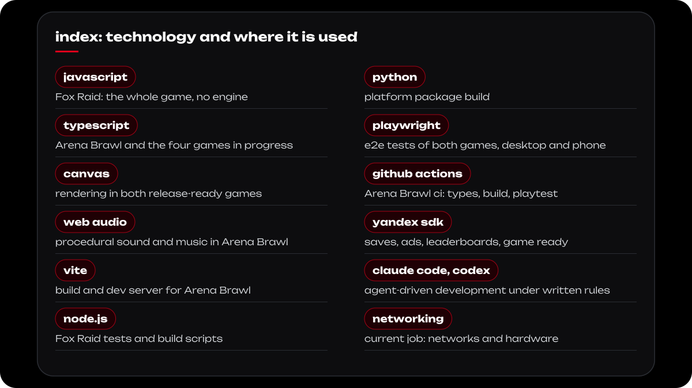</picture>

<picture><source media="(max-width: 700px)" srcset="assets/v3/band-signal-en-m.svg"></picture>

<a href="https://t.me/mysoldroom"><picture><source media="(max-width: 700px)" srcset="assets/v3/notes-en-m.svg"></picture></a>

<a href="https://t.me/mysoldroom"><picture><source media="(max-width: 700px)" srcset="assets/v3/signal-en-m.svg"></picture></a>

<picture><source media="(max-width: 700px)" srcset="assets/v3/footer-en-m.svg"></picture>

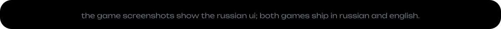
