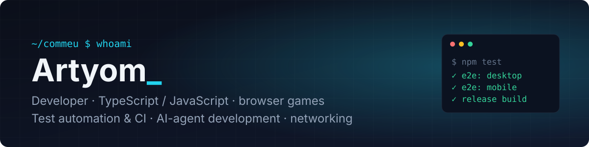
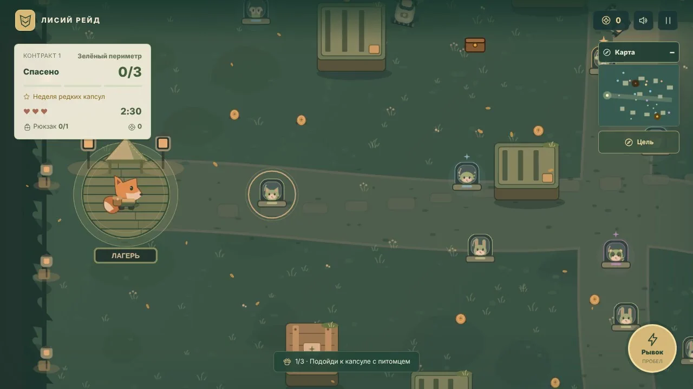

<a href="https://github.com/commeu">Русский</a> · <b>English</b>

  

  
  
  

## About

- **1.5 years in IT:** network infrastructure and software development.
- **I build browser games** in TypeScript and JavaScript for Yandex Games: mechanics, UI, platform SDK integration, release builds and test automation.
- **I run development around AI agents.** Agents follow written rules and keep a run log, and every change they make goes through automated tests. Task definition, architecture and acceptance are on me.
- **Looking for remote work:** software development, test automation, infrastructure and DevOps.

## Stack

**Languages** 

**Frontend and games** 

**Testing, CI and infrastructure** 

**AI-assisted development** 

## Projects

> The repositories are private while the games are being prepared for release. Happy to walk through the code and a live demo — message me on Telegram.

### Fox Raid · `v1.19.2`

A stealth arcade game for Yandex Games: a fox sneaks into guarded territory, frees creatures from capsules and escapes the guards before the timer runs out.

  

<table>
  <tr>
    <td width="50%"> Camp: progress, daily raid, weekly event</td>
    <td width="50%"> Boss raid: searchlight that telegraphs its next sweep</td>
  </tr>
  <tr>
    <td width="50%"> Alarm: reach the siren in time to switch it off</td>
    <td width="50%"> Collection: 30 creatures with star levels and abilities</td>
  </tr>
</table>

The game UI in the media is in Russian; the game itself ships in Russian and English.

- **No engine:** plain JavaScript and Canvas with zero production dependencies; builds into a single self-contained HTML file plus a ZIP for the platform.
- **Content:** 5 zones, 30 creatures, procedural contracts, daily and weekly events, an endless mode, a boss raid, 22 medals, RU/EN.
- **Performance:** automatic quality profiles with a pixel budget, a memory-capped sprite cache, and a 60 Hz simulation decoupled from rendering.
- **Data safety:** cloud saves keyed to a persistent player ID, protected against races when the account switches.
- **Accessibility:** large text, high contrast, reduced motion, left-handed mode; verified on 7 screen sizes from 320×568 to 1280×720.

| Test suite | What it covers |
|---|---|
| `npm test` | mechanics, saves, graphics quality |
| `test:browser` | controls, SDK scenarios, account recovery, accessibility (Playwright) |
| `codex:release` | the built HTML and ZIP: real input, reload, no test code shipped |
| `test:local-layouts` | 28 combinations of RU/EN × 7 screen sizes |
| `test:progression` | full playthrough of every zone by an automated pilot |
| `test:performance` | load of an active scene and a throttled CPU |

### Arena Brawl · `TypeScript` `Vite` `v1.0`

A top-down team action game: 8 heroes with unique attacks and super moves, 3 modes, 6 maps.

- Bot AI: line-of-sight target selection, range keeping, retreat at low health, obstacle avoidance, per-mode behaviour.
- Controls on desktop (WASD + mouse) and on phones (twin sticks with auto-aim).
- Procedural sound and music on Web Audio, progression, daily quests, cloud saves, leaderboard.
- Playwright e2e playtest on desktop and mobile: every hero, every mode to the end, saves; GitHub Actions.

### In progress

Four more games on a shared TypeScript template with Yandex SDK integration, e2e tests and a release build: a flea-market tycoon, a ragdoll sandbox, a physics shooting range and a loot-heist obby.

## How I work

- **Bug → test → fix.** I reproduce the problem in a test with "before" measurements first, then fix it and take the same measurements "after".
- **One logical change per commit.** The version only bumps on player-visible changes; history lives in a CHANGELOG.
- **AI agents under a written process.** Rules in `AGENTS.md` / `CLAUDE.md`, a run log and test reports. Every agent change is checked by the test suites.
- **Priorities:** data safety → controls → readability → performance → everything else.

## Currently learning

Docker and containers, service monitoring, integrating LLMs into products (model APIs, RAG).

---

Message me on Telegram: <a href="https://t.me/mysoldroom">@mysoldroom</a>

