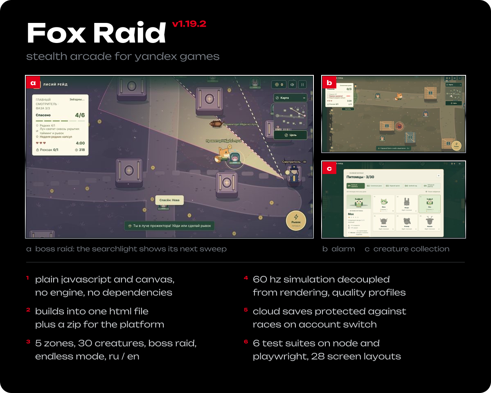
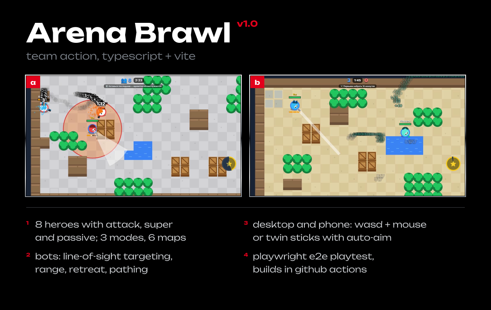
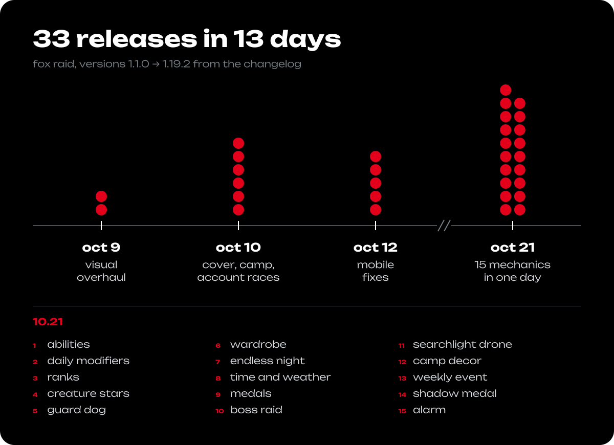
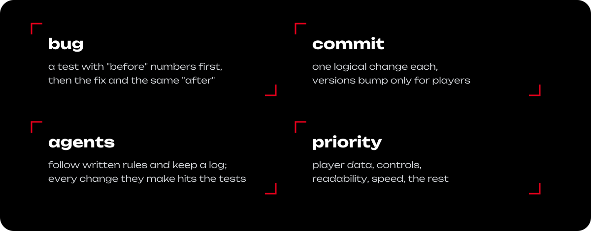
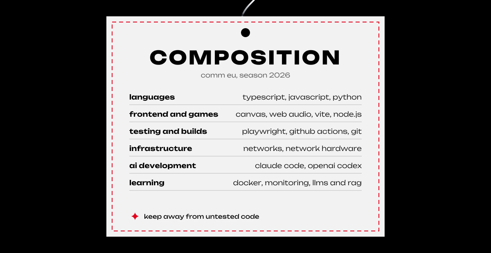

<p align="right"><a href="https://github.com/commeu">ru</a> / <b>en</b></p>

<picture><source media="(max-width: 700px)" srcset="assets/v3/hero-en-m.svg"></picture>

<p align="center">
comm eu writes code, sets up networks and builds games for the browser.<br>
1.5 years in it: networks and hardware, scripts, in-house software and its automation.<br>
leads a team of 7+ people and works with clients directly.
</p>

<p align="center">
<a href="#objects">objects²</a> &nbsp;/&nbsp; <a href="#chronicle">chronicle³</a> &nbsp;/&nbsp; <a href="#method">method⁴</a> &nbsp;/&nbsp; <a href="#stack">composition⁵</a> &nbsp;/&nbsp; <a href="#signal">signal⁶</a>
</p>

<details>
<summary><b>navigator:</b> where to look for your role</summary>
<br>

| role | section | what you will find |
|---|---|---|
| frontend, web | <a href="#objects">2.1</a>, <a href="#stack">5</a> | canvas with no engine or dependencies, 28 screen layouts, one-file html build |
| game dev | <a href="#objects">2.1</a>, <a href="#objects">2.2</a>, <a href="#chronicle">3</a> | two release-ready games, four more on a shared template, 33 releases in 13 days |
| qa, test automation | <a href="#objects">2.1</a>, <a href="#method">4</a> | 6 test suites on node and playwright, test before fix, e2e on desktop and phone |
| devops, infrastructure | <a href="#objects">2.3</a>, <a href="#objects">2.1</a> | networks and hardware, automation, github actions ci with artifacts |
| team lead, manager | <a href="#objects">2.3</a>, <a href="#method">4</a>, <a href="#chronicle">3</a> | a team of 7+, client work, agent-driven development under written rules |

</details>

<a id="objects"></a>
<picture><source media="(max-width: 700px)" srcset="assets/v3/band-objects-en-m.svg"></picture>

<picture><source media="(max-width: 700px)" srcset="assets/v3/group-release-en-m.svg"></picture>

<picture><source media="(max-width: 700px)" srcset="assets/v3/fox-raid-en-m.svg"></picture>

<details>
<summary><b>Fox Raid:</b> tests, platform, project layout</summary>
<br>

| test suite | what it covers |
|---|---|
| `npm test` | mechanics, saves, graphics quality, the first 20 contracts |
| `test:browser` | controls, sdk scenarios, account recovery, accessibility (playwright) |
| `codex:release` | the built html and zip: real input, reload, no test code shipped |
| `test:local-layouts` | 28 combinations of ru/en and 7 screen sizes, large text and contrast |
| `test:progression` | a full playthrough of every zone and the collection by an automated pilot |
| `test:performance` | load of an active scene and a throttled cpu |

**platform:** cloud saves keyed to a persistent player id, pause when minimized, rewarded ads only when the player opts in, yandex game ready and gameplay api. the sdk is mocked in tests; real devices and ads are checked in a platform draft.

```
game/      sources: core, platform, art, quality, motion
tests/     node and playwright tests (50 files)
scripts/   package build, media, diagnostics
docs/      state, reports, test evidence
media/     screenshots and before/after frames
```

</details>

<picture><source media="(max-width: 700px)" srcset="assets/v3/arena-en-m.svg"></picture>

<details>
<summary><b>Arena Brawl:</b> build pipeline and project layout</summary>
<br>

every push to main runs through github actions:

1. typescript type check
2. build
3. zip for the platform
4. e2e playtest in chromium: all 8 heroes, three modes to the end, trophy road, upgrades, saves
5. playtest screenshots and the game archive are kept as artifacts

```
src/game/heroes.ts    8 heroes: stats, supers, passives, upgrade costs
src/game/maps.ts      6 mirrored maps and modes
src/game/arena.ts     combat simulation and bot ai
src/game/progress.ts  saves, trophy road, quests
src/render/draw.ts    arena rendering with cached map layers
src/audio/sfx.ts      procedural sound and music
tests/e2e.cjs         playwright playtest
```

</details>

<picture><source media="(max-width: 700px)" srcset="assets/v3/group-wip-en-m.svg"></picture>

| game | genre | base |
|---|---|---|
| Flea Market Tycoon | tycoon | typescript, yandex sdk, e2e tests |
| Ragdoll Playground | physics sandbox | typescript, yandex sdk, e2e tests |
| Proving Ground | physics shooting range | typescript, yandex sdk, e2e tests |
| Loot Heist | obby | typescript, yandex sdk, e2e tests |

<picture><source media="(max-width: 700px)" srcset="assets/v3/group-infra-en-m.svg"></picture>

<p>
┌<br>
at my current job: setting up networks and network hardware,<br>
scripts and in-house software, automating how they run and get checked.<br>
i lead a team of 7+ people and take clients from requirements to delivery myself.<br>
└
</p>

<a id="chronicle"></a>
<picture><source media="(max-width: 700px)" srcset="assets/v3/band-chronicle-en-m.svg"></picture>

<picture><source media="(max-width: 700px)" srcset="assets/v3/chronicle-en-m.svg"></picture>

<a id="method"></a>
<picture><source media="(max-width: 700px)" srcset="assets/v3/band-method-en-m.svg"></picture>

<picture><source media="(max-width: 700px)" srcset="assets/v3/method-en-m.svg"></picture>

<a id="stack"></a>
<picture><source media="(max-width: 700px)" srcset="assets/v3/band-stack-en-m.svg"></picture>

<picture><source media="(max-width: 700px)" srcset="assets/v3/tag-en-m.svg"></picture>

<details>
<summary><b>index:</b> technology → where it is used</summary>
<br>

| technology | where |
|---|---|
| javascript | Fox Raid: the whole game, no engine |
| typescript | Arena Brawl and the four games in progress |
| canvas | rendering in both release-ready games |
| web audio | procedural sound and music in Arena Brawl |
| vite | build and dev server for Arena Brawl |
| node.js | Fox Raid tests and build scripts |
| python | Fox Raid platform package build |
| playwright | e2e tests of both games on desktop and phone |
| github actions | Arena Brawl ci: types, build, playtest, artifacts |
| yandex sdk | cloud saves, ads, leaderboards, game ready |
| claude code, codex | agent-driven development under written rules |
| networking | current job: networks and network hardware |

</details>

<a id="signal"></a>
<picture><source media="(max-width: 700px)" srcset="assets/v3/band-signal-en-m.svg"></picture>

<a href="https://t.me/mysoldroom"><picture><source media="(max-width: 700px)" srcset="assets/v3/signal-en-m.svg"></picture></a>

<picture><source media="(max-width: 700px)" srcset="assets/v3/footer-en-m.svg"></picture>

<p align="center"><sub>the game screenshots show the russian ui; both games ship in russian and english.</sub></p>
