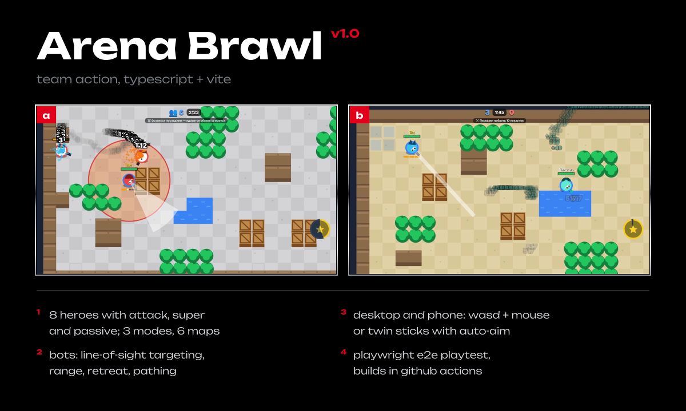
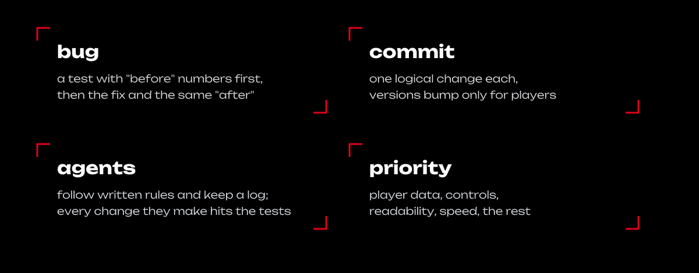

<a href="https://github.com/commeu">ru</a> / <b>en</b>

comm eu writes code, sets up networks and builds games for the browser. 
1.5 years in it: networks and hardware, scripts, in-house software and its automation. 
leads a team of 7+ people and works with clients directly.

four more games on a shared typescript template with the yandex sdk and e2e tests: 
a flea-market tycoon, a ragdoll sandbox, a physics range, a loot-heist obby. 
the code stays private until release. happy to walk through it on a call.

the game screenshots show the russian ui; both games ship in russian and english.

