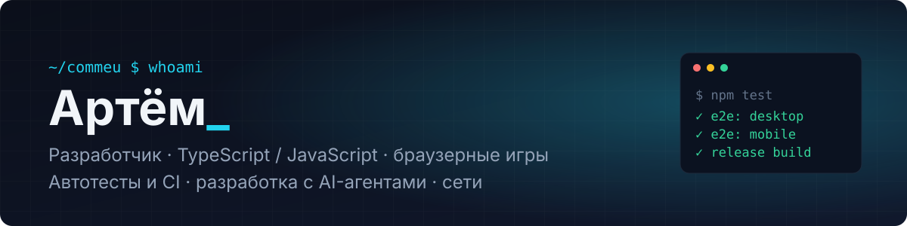
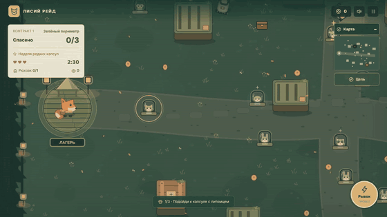
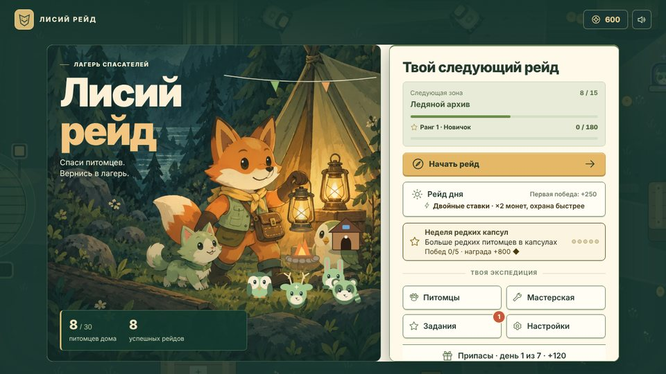
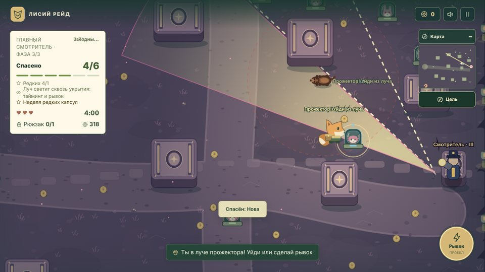
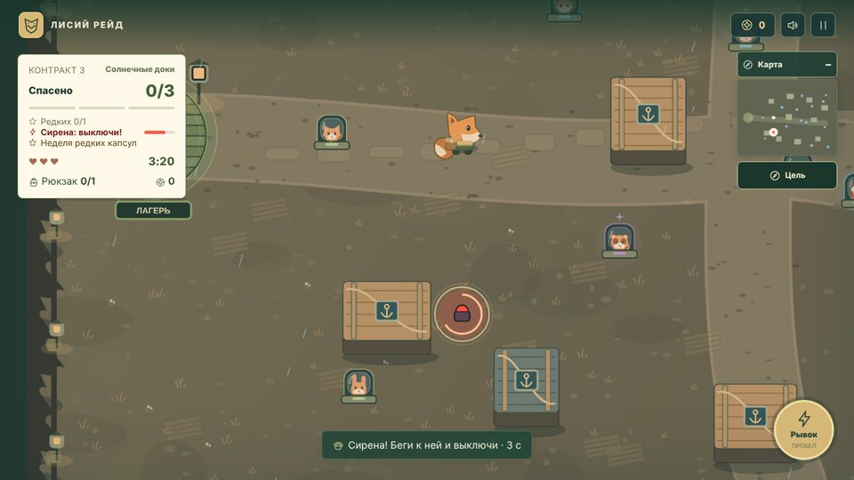
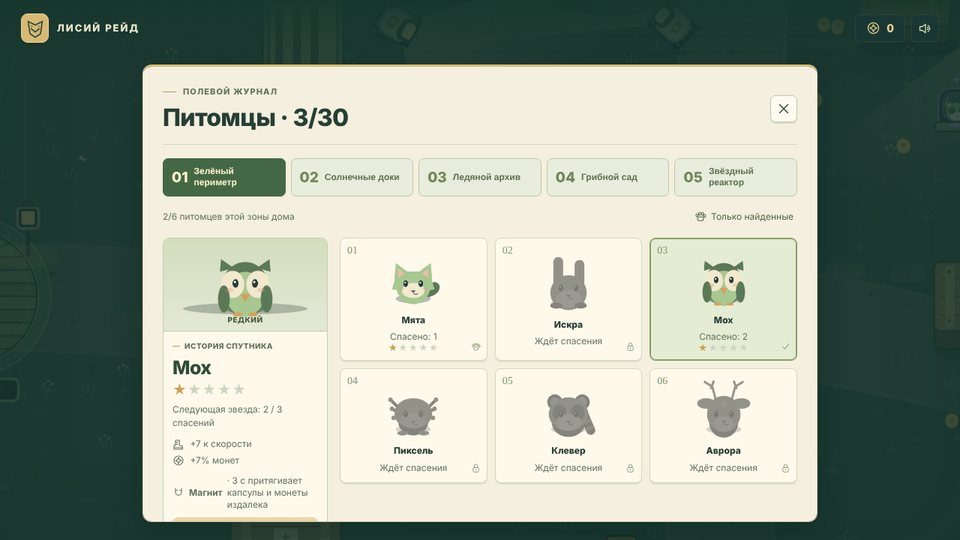

  

  
  
  

## Обо мне

- **1,5 года в IT:** сетевая инфраструктура и разработка ПО.
- **Делаю браузерные игры** на TypeScript и JavaScript для Яндекс Игр: механики, интерфейс, интеграция с SDK, релизная сборка и автотесты.
- **Строю разработку вокруг AI-агентов.** Агенты работают по письменным правилам и ведут журнал, а каждое их изменение проходит автотесты. Задачи, архитектура и приёмка за мной.
- **Ищу удалённую работу:** разработка, автоматизация и тестирование, инфраструктура и DevOps.

## Стек

**Языки** 

**Фронтенд и игры** 

**Тесты, CI и инфраструктура** 

**AI-разработка** 

## Проекты

> Репозитории закрытые: игры готовятся к публикации. Код и демо покажу по запросу в Telegram.

### Лисий рейд / Fox Raid · `v1.19.2`

Стелс-аркада для Яндекс Игр: лис пробирается на охраняемую территорию, освобождает питомцев и уходит от охраны до конца таймера.

  

<table>
  <tr>
    <td width="50%"> Лагерь: прогресс, рейд дня, событие недели</td>
    <td width="50%"> Босс-рейд: прожектор с прогнозом следующего хода</td>
  </tr>
  <tr>
    <td width="50%"> Тревога: сирену можно успеть выключить</td>
    <td width="50%"> Коллекция: 30 питомцев со звёздами и способностями</td>
  </tr>
</table>

- **Без движков:** чистый JavaScript и Canvas, ноль production-зависимостей; сборка в один автономный HTML-файл и ZIP для платформы.
- **Контент:** 5 зон, 30 питомцев, процедурные контракты, ежедневные и недельные события, бесконечный режим, босс-рейд, 22 медали, RU/EN.
- **Производительность:** автоматические профили качества с лимитом пикселей, кэш спрайтов с ограничением памяти, симуляция 60 Гц отдельно от отрисовки.
- **Надёжность данных:** облачные сохранения по постоянному ID игрока с защитой от гонок при смене аккаунта.
- **Доступность:** крупный текст, высокий контраст, уменьшенные анимации, режим для левой руки; проверка 7 размеров экрана от 320×568 до 1280×720.

| Набор тестов | Что проверяет |
|---|---|
| `npm test` | механика, сохранения, качество графики |
| `test:browser` | управление, сценарии SDK, восстановление аккаунта, доступность (Playwright) |
| `codex:release` | собранные HTML и ZIP: реальный ввод, reload, отсутствие тестового кода |
| `test:local-layouts` | 28 сочетаний RU/EN × 7 размеров экрана |
| `test:progression` | полное прохождение всех зон автоматическим навигатором |
| `test:performance` | нагрузка активной сцены и замедленный CPU |

### Арена Бойцов · `TypeScript` `Vite` `v1.0`

Командный экшен с видом сверху: 8 героев с уникальными атаками и суперударами, 3 режима, 6 карт.

- ИИ ботов: выбор цели по видимости, удержание дистанции, отступление при низком здоровье, обход препятствий, поведение под режим.
- Управление на ПК (WASD + мышь) и на телефоне (два стика, автоприцел).
- Процедурный звук и музыка на Web Audio, прогрессия, ежедневные задания, облачные сохранения, лидерборд.
- e2e-плейтест на Playwright на ПК и телефоне: все герои, все режимы до конца, сохранение; GitHub Actions.

### В разработке

Четыре игры на общем TypeScript-шаблоне с интеграцией Яндекс SDK, e2e-тестами и сборкой релиза: **Перекуп: Барахолка**, **Тряпичная Песочница**, **Полигон**, **Утащи Лут!**

## Как я работаю

- **Баг → тест → правка.** Сначала воспроизвожу проблему в тесте с замерами «до», затем исправляю и снимаю те же замеры «после».
- **Одно логическое изменение — один коммит.** Версия растёт только при видимом пользователю изменении, история ведётся в CHANGELOG.
- **AI-агенты по регламенту.** Правила работы в `AGENTS.md` / `CLAUDE.md`, журнал запусков, отчёты проверок. Каждое изменение агента проверяется автотестами.
- **Приоритеты:** сохранность данных → управление → читаемость → производительность → всё остальное.

## Сейчас изучаю

Docker и контейнеризацию, мониторинг сервисов, интеграцию LLM в продукты (API моделей, RAG).

---

Пишите в Telegram: <a href="https://t.me/mysoldroom">@mysoldroom</a>

