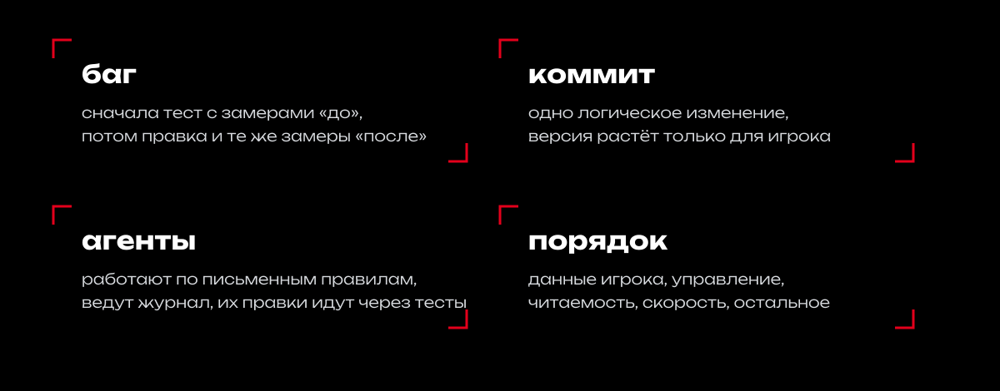

<b>ru</b> / <a href="https://github.com/commeu/commeu/blob/main/README.en.md">en</a>

comm eu пишет код, настраивает сети и собирает игры для браузера. 
полтора года в it: сети и оборудование, скрипты, свой софт и его автоматизация. 
веду команду из 7+ человек и работаю с клиентами напрямую.

ещё четыре игры на общем typescript-шаблоне с яндекс sdk и e2e-тестами: 
барахолка-тайкун, тряпичная песочница, физический полигон, лут-обби. 
код закрыт до релиза. покажу на созвоне.

