
 

<picture><source media="(max-width: 700px)" srcset="assets/v3/hero2-ru-m.svg"></picture>

<picture><source media="(max-width: 700px)" srcset="assets/v3/intro-ru-m.svg">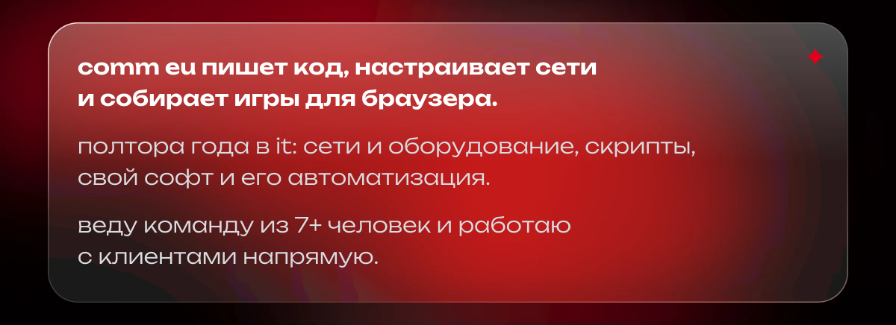</picture>

<picture><source media="(max-width: 700px)" srcset="assets/v3/widgets-ru-m.svg"></picture>

<a href="#method"></a>
<a href="#stack"></a>

<picture><source media="(max-width: 700px)" srcset="assets/v3/group-nav-ru-m.svg"></picture>

<a href="#release"><picture><source media="(max-width: 700px)" srcset="assets/v3/role-1-ru-m.svg">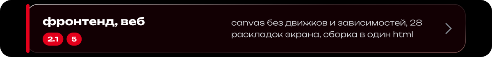</picture></a>
<a href="#release"><picture><source media="(max-width: 700px)" srcset="assets/v3/role-2-ru-m.svg">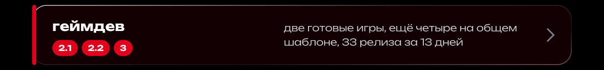</picture></a>
<a href="#release"><picture><source media="(max-width: 700px)" srcset="assets/v3/role-3-ru-m.svg"></picture></a>
<a href="#infra"><picture><source media="(max-width: 700px)" srcset="assets/v3/role-4-ru-m.svg">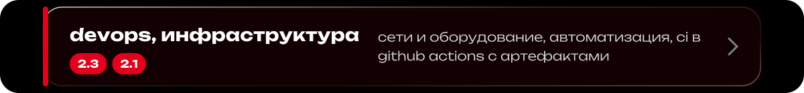</picture></a>
<a href="#infra"><picture><source media="(max-width: 700px)" srcset="assets/v3/role-5-ru-m.svg">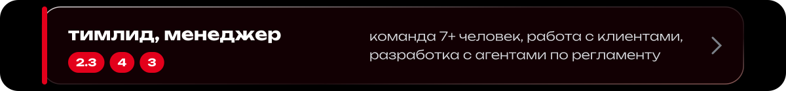</picture></a>

<picture><source media="(max-width: 700px)" srcset="assets/v3/band-objects-ru-m.svg"></picture>

<picture><source media="(max-width: 700px)" srcset="assets/v3/group-release-ru-m.svg"></picture>

<picture><source media="(max-width: 700px)" srcset="assets/v3/fox-raid-ru-m.svg"></picture>

<picture><source media="(max-width: 700px)" srcset="assets/v3/group-spec-ru-m.svg"></picture>

<picture><source media="(max-width: 700px)" srcset="assets/v3/fox-spec-ru-m.svg">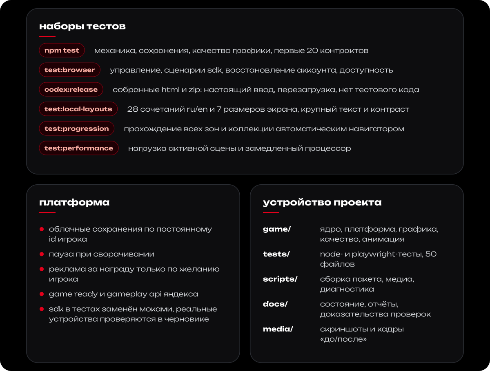</picture>

<picture><source media="(max-width: 700px)" srcset="assets/v3/arena-ru-m.svg">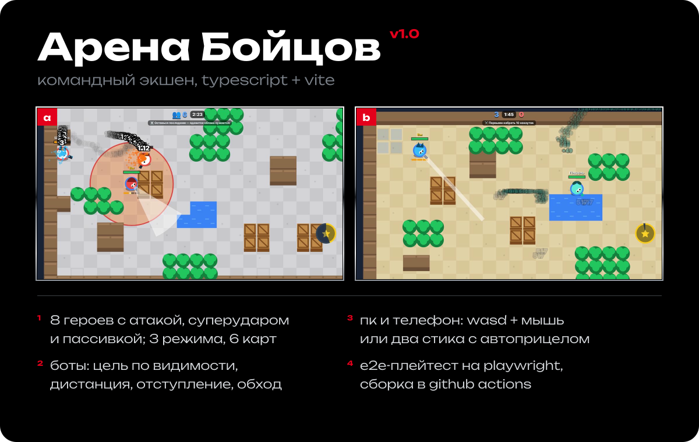</picture>

<picture><source media="(max-width: 700px)" srcset="assets/v3/group-pipe-ru-m.svg"></picture>

<picture><source media="(max-width: 700px)" srcset="assets/v3/arena-spec-ru-m.svg"></picture>

<picture><source media="(max-width: 700px)" srcset="assets/v3/group-wip-ru-m.svg"></picture>

<picture><source media="(max-width: 700px)" srcset="assets/v3/wip-ru-m.svg">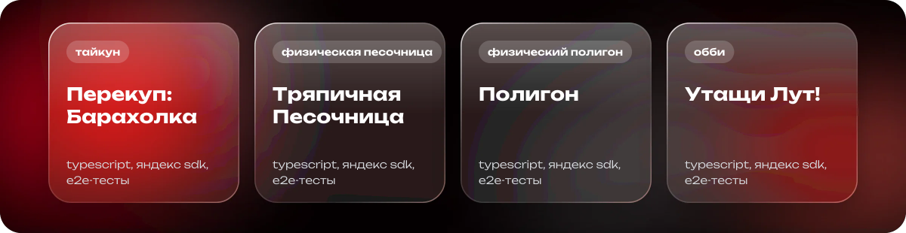</picture>

<picture><source media="(max-width: 700px)" srcset="assets/v3/group-infra-ru-m.svg"></picture>

<picture><source media="(max-width: 700px)" srcset="assets/v3/infra-ru-m.svg">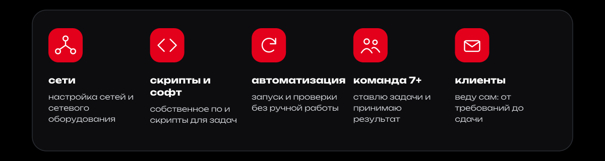</picture>

<picture><source media="(max-width: 700px)" srcset="assets/v3/band-chronicle-ru-m.svg"></picture>

<picture><source media="(max-width: 700px)" srcset="assets/v3/chronicle-ru-m.svg">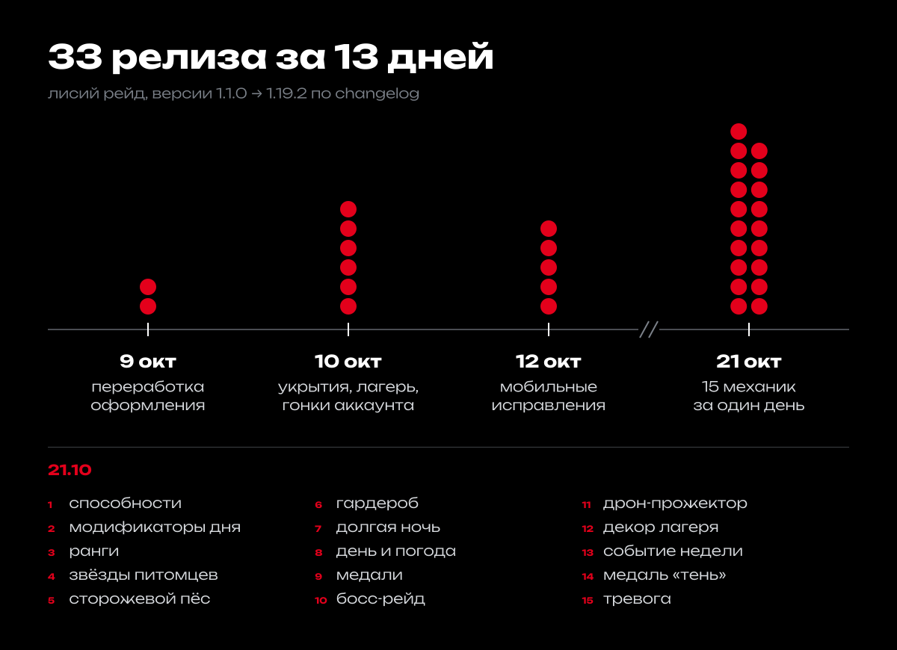</picture>

<picture><source media="(max-width: 700px)" srcset="assets/v3/band-method-ru-m.svg"></picture>

<picture><source media="(max-width: 700px)" srcset="assets/v3/method-ru-m.svg">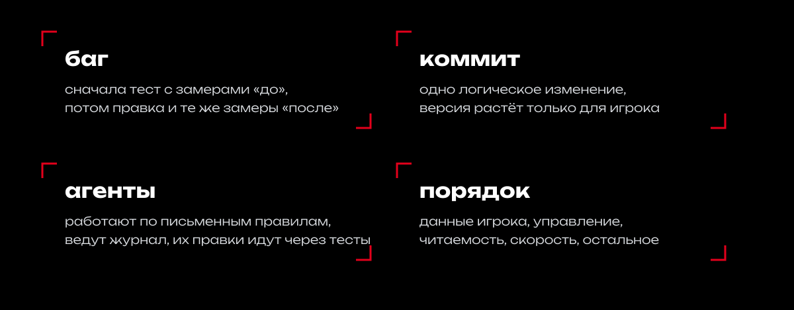</picture>

<picture><source media="(max-width: 700px)" srcset="assets/v3/band-stack-ru-m.svg"></picture>

<picture><source media="(max-width: 700px)" srcset="assets/v3/tag-ru-m.svg">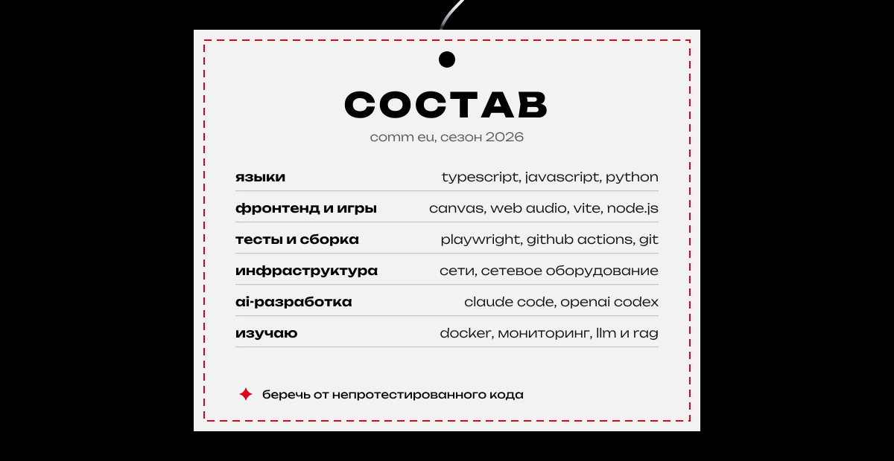</picture>

<picture><source media="(max-width: 700px)" srcset="assets/v3/index-ru-m.svg">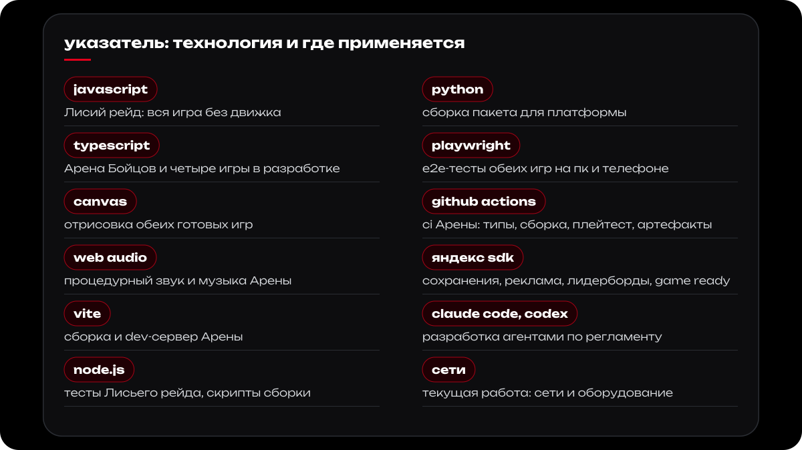</picture>

<picture><source media="(max-width: 700px)" srcset="assets/v3/band-signal-ru-m.svg"></picture>

<a href="https://t.me/mysoldroom"><picture><source media="(max-width: 700px)" srcset="assets/v3/notes-ru-m.svg"></picture></a>

<a href="https://t.me/mysoldroom"><picture><source media="(max-width: 700px)" srcset="assets/v3/signal-ru-m.svg"></picture></a>

<picture><source media="(max-width: 700px)" srcset="assets/v3/footer-ru-m.svg"></picture>
